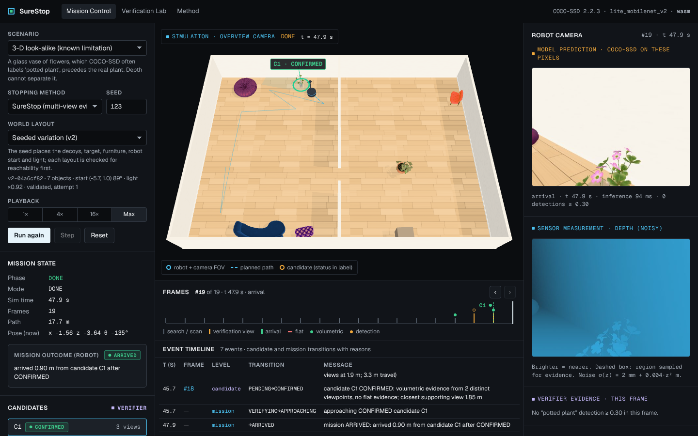
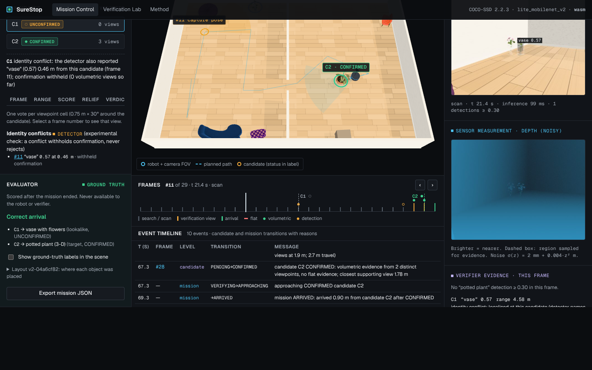
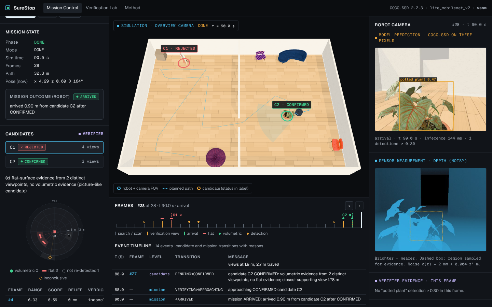

# SureStop

**Find. Verify. Then arrive.**

SureStop is a browser-based robot simulation in which a robot must check, with depth evidence from
several viewpoints, that the object it found really is its target before it reports arrival.

**Live demo:** [Open SureStop in your browser](https://surestop-robot-verification-release.vercel.app/)

- **What it is:** a software simulation that runs entirely in your browser (a desktop browser with
  WebGL2). It does not control a physical robot.
- **Open provenance warning:** the hosted build is reported to show a dirty source tree
  (`sourceDirty: true`), so it is not yet shown to be built exactly from this repository's commit.
  See [`BUILD_STATUS.md`](BUILD_STATUS.md#deployment).

- **The problem:** an object detector that says "potted plant" is not proof that the robot has
  reached a real potted plant. A photo, a screen or a look-alike can produce the same label.
- **The approach:** treat a detection as a *candidate*. Collect depth evidence from distinct
  viewpoints, confirm only on sufficient 3-D evidence, reject flat pictures, and withhold
  confirmation (keep searching) when the evidence is insufficient or contradictory.

Built for the Hack in Hills ’26 *Vision-Based Autonomous Robot* track by Team Nexora4.

> [!IMPORTANT]
> **What this is:**
> - a simulation running in the browser;
> - a real object detector (COCO-SSD) running on the robot's rendered camera pixels;
> - reproducible development evidence.
>
> **What this is not:** a physical robot, a ROS 2/Nav2/Gazebo integration, a safety-validated
> system, or a general semantic-identity system. The evaluation is on development scenarios and is
> **not** independent scientific validation; see [Limitations](#limitations-and-non-goals).

## Contents

- [Why false arrival matters](#why-false-arrival-matters)
- [What SureStop does](#what-surestop-does)
- [How it works](#how-it-works)
- [Screenshots](#screenshots)
- [Getting started](#getting-started)
- [Using the application](#using-the-application)
- [Reproducing the three demo scenarios](#reproducing-the-three-demo-scenarios)
- [Testing](#testing)
- [Evaluation results](#evaluation-results)
- [Reproduce experiments](#reproduce-experiments)
- [World layouts (v1 and v2)](#world-layouts-v1-and-v2)
- [Limitations and non-goals](#limitations-and-non-goals)
- [Project structure](#project-structure)
- [Troubleshooting](#troubleshooting)
- [Documentation index](#documentation-index)
- [Licences and attribution](#licences-and-attribution)

## Why false arrival matters

A robot sent to "the potted plant" typically searches until its detector reports that class above
a score threshold, then drives there and declares arrival. Detection is a plausibility signal, not
evidence of identity. In this project's own measurements on rendered scenes
([`PERCEPTION_FEASIBILITY.md`](PERCEPTION_FEASIBILITY.md)):

- COCO-SSD labels flat prints and screens showing the plant as "potted plant", at scores up to 0.86
  and 0.80.
- It labels a 3-D glass vase of flowers "potted plant" in 10 of 24 views at ≥ 0.5.

A threshold rule that stops on such a detection reports success at the wrong object. Downstream
behaviour (a delivery, an inspection, a hand-over) then happens in the wrong place, while the robot
believes it succeeded.

How often this happens on real robots depends on the detector, environment and route. The
simulation demonstrates the mechanism; it does not estimate a real-world rate.

## What SureStop does

The robot follows a search route in a two-room Three.js scene. COCO-SSD runs on the pixels of its
640 × 480 camera, and a pixel-aligned simulated depth sensor (with a noise model) measures the
same view. A detection of the target class becomes a candidate track, and a candidate must be
verified before the robot may stop at it.

**Core verification (SureStop, method `surestop`)**, implemented before the latest change:

- **Per-view depth evidence.** Inside the detection box the verifier measures *relief*, the depth
  structure above sensor noise, plus a two-plane check. Each view is classified VOLUMETRIC, FLAT or
  INCONCLUSIVE. Evidence gates: relief ≥ 60 mm is volumetric, ≤ 25 mm is flat, expected noise
  ≤ 30 mm, detector score ≥ 0.4.
- **Distinct viewpoints.** Each 0.75 m × 30° viewpoint cell around the candidate casts at most one
  vote, so repeated frames from one place cannot add up to "multi-view" evidence.
- **Decisions:**
  - **CONFIRMED** needs 2 volumetric viewpoints, no flat evidence, and one supporting view within
    2.5 m.
  - **REJECTED** needs 2 flat viewpoints, or 3 views in which the candidate is not re-detected.
  - Otherwise the candidate ends **UNCONFIRMED** when the 4-viewpoint budget is spent.
- **Bounded re-observation.** A planner chooses up to 4 reachable viewpoints around a candidate.
  Arrival is declared only after a CONFIRMED decision; otherwise the search continues.

**The newest change: identity-conflict check (method `surestop-identity`, experimental).**

- **Why it exists:** depth cannot reject a 3-D look-alike, because the vase of flowers is
  genuinely volumetric. In `lookalike-3d` seed 123 (layout `v2-04a6cf82`), the original method
  therefore confirms the vase and arrives there.
- **What it does:** it uses the detector's *own* confusable-class output. If COCO-SSD also
  reports "vase" (score ≥ 0.3, valid depth), that detection is localised exactly like a target
  detection. If it lies within the 0.9 m association gate of a pending candidate, from any frame,
  confirmation is withheld. The candidate ends UNCONFIRMED (never REJECTED) and the search
  continues.
- **Scope:** the confusable-class table has exactly one entry,
  `potted plant → vase` ([`src/verify/identity.ts`](src/verify/identity.ts)). This is a
  conflict rule over detector labels, **not** a semantic identity model. It does nothing if the
  detector never calls the look-alike "vase".
- **Status:** it met its frozen development criteria, so Mission Control preselects it. It
  remains labelled experimental, and `surestop` is unchanged and still available.

**Traceability.** Every decision links back to the frames that produced it. Selecting an earlier
frame shows that frame's camera image, depth, detections and identity conflicts, together with
the robot's *capture-time* pose (an amber marker in the 3-D view and a "Pose at #N" row), shown
separately from the live pose.

**Evaluation separation.** A separate evaluator module scores each mission against ground truth
only after the mission ends. The robot, verifier and policies never receive ground truth, object
identifiers or the scene graph; `tests/unit/isolation.test.ts` checks this.

### Features

| Feature | Why it matters |
|---|---|
| Real COCO-SSD 2.2.3 inference on rendered pixels, with self-hosted weights | Detection errors are the detector's own, not scripted |
| Pixel-aligned depth with a noise model, σ(z) = 2 mm + 0.004·z² m | Flat and 3-D evidence is measured, not looked up |
| Multi-view verification with viewpoint cells and a bounded re-observation planner | Separates pictures from objects and caps the extra cost |
| Experimental identity-conflict check (`surestop-identity`) | Withholds confirmation of the vase look-alike that depth cannot reject |
| Baselines: single-frame threshold, temporal persistence, one-view SureStop ablation | Lets you compare against simpler stopping rules in the same worlds |
| Seven seeded scenarios, two world layouts (v1 recorded, v2 seeded variation) | Deterministic, repeatable worlds; v2 moves objects with the seed |
| Mission Control (`/console`) with a frame scrubber, evidence tables, viewpoint roses and capture-time poses | Every decision is inspectable frame by frame |
| Verification Lab (`/lab`) | Recomputes the recorded results in the browser with denominators and Wilson 95 % intervals, runs live batches, exports CSV/JSON |
| Method page (`/method`) | Methodology, recorded results, chronology and limitations |
| Batch tooling (`scripts/`) with durable checkpoints, resume, merge and compare | Experiments can be re-run and compared run by run |

## How it works

```
 seeded world (scenario × seed × layout)
        │
        ▼
 robot follows the search route ──► camera frame (RGB 640×480) + depth frame (noisy)
        │                                   │
        │                                   ▼
        │                    COCO-SSD (TF.js; WebGL, or WASM on software GPUs)
        │                                   │
        │              "potted plant" ≥ 0.30 with valid depth ──► back-project ──► candidate track
        │              (surestop-identity: "vase" ≥ 0.30 is localised the same way ──► conflict)
        │                                   │
        │                                   ▼
        │                    per-view evidence: VOLUMETRIC / FLAT / INCONCLUSIVE / miss
        │                    one vote per 0.75 m × 30° viewpoint cell
        │                                   │
        │                    re-observation planner (≤ 4 viewpoints)
        │                                   │
        │          ┌────────────────────────┼─────────────────────────┐
        │      CONFIRMED                REJECTED                 UNCONFIRMED
        │   (approach, stop:         (flat / not            (budget spent, or an
        │    ARRIVED)                 reproducible)          identity conflict)
        │                                   └───────────┬─────────────┘
        └────────────────────── continue the search ◄───┘
                                               │
              route exhausted ──► NOT_FOUND (or UNRESOLVED if a candidate stayed unresolved)

 after the mission: separate evaluator (ground truth) ──► Correct arrival / False arrival / …
```

| Module | Path |
|---|---|
| Scene, assets, RGB + depth renderer, world builder | `src/sim/` |
| COCO-SSD wrapper and backend selection | `src/perception/` |
| Depth features (relief, two-plane RANSAC) | `src/sensing/` |
| Evidence rules, viewpoint cells, SureStop verifier, identity-conflict table, planner | `src/verify/` |
| Stopping policies (single-frame, persistence, SureStop) | `src/policies/` |
| Mission runner (search, verify, approach) and browser sensor | `src/mission/` |
| Occupancy grid and A* | `src/nav/` |
| Scenarios, seeded v2 generator, layout validator | `src/scenarios/` |
| Evaluator, metrics, export | `src/eval/` |
| Batch engine and seed protocol | `src/experiments/` |
| UI (Mission Control, Lab, pages) | `src/console/`, `src/lab/`, `src/app/` |

**Technology** (versions from `package.json` and `package-lock.json`):

| | Version |
|---|---|
| Next.js | 16.4.3 (React 19.2.9), TypeScript 5.9.3 |
| Three.js | 0.186.1 |
| TensorFlow.js | 4.22.0 (core, converter, WebGL, WASM and CPU backends) |
| COCO-SSD | 2.2.3, `lite_mobilenet_v2`, weights served from `public/models/` |
| Vitest | 4.1.12 (unit tests) |
| Playwright | 1.56.1 (browser tests) |
| ESLint | 9.39.5 with `eslint-config-next` |

There is no backend, database, account or API key. The application is static and client-side.

## Screenshots

These screenshots come from the recorded UI rehearsal of the demo scenarios
([`docs/demo/rehearsal/`](docs/demo/rehearsal/)). They are captures of the real application, not
mock-ups.

**Original SureStop confirms the vase** (`lookalike-3d`, seed 123, `surestop`): C1 CONFIRMED,
mission ARRIVED; the evaluator later reads "False arrival".



**The identity-conflict check withholds it** (same world, `surestop-identity`): C1 UNCONFIRMED
because the detector also reported "vase" (0.57) 0.46 m from it in frame 11; C2, the real plant,
is CONFIRMED.


**Traceability:** frame 11 selected. The camera shows the "vase 0.57" box, and *Pose at #11*
shows where the robot stood when it captured the frame, next to its live pose.



**A flat decoy, detected and rejected** (`photo-board-decoy`, seed 17, `surestop-identity`): the
life-size photo board is labelled "potted plant" up to 0.99 and REJECTED on flat evidence from 2
viewpoints. The plant is CONFIRMED.



These screenshots were taken on a local production build of this release, not on the hosted demo.
The hosted demo is linked at the top of this page; its status is in
[`BUILD_STATUS.md`](BUILD_STATUS.md#deployment).

## Getting started

### Prerequisites

- **Node.js ≥ 20.9** (`package.json` `engines`) and **npm**. The release was validated with
  Node 22.22.0 and npm 10.9.4.
- **Browser:** a desktop browser with **WebGL2**, such as current Chrome, Edge or Firefox.
- **Downloads:** none at runtime. The detector weights (about 18 MB), the TF.js WASM binaries and
  the 3-D assets are in `public/`.

### Install and run

```bash
git clone https://github.com/adithyad-cs/surestop-robot-verification-release.git
cd surestop-robot-verification-release
npm ci                      # installs exactly what package-lock.json pins (.npmrc: legacy-peer-deps)

npm run dev                 # development server: http://localhost:3000
# or a production build:
npm run build && npm start  # http://localhost:3000
```

Open `http://localhost:3000` and choose **ENTER SYSTEM**, or go straight to
`http://localhost:3000/console`.

### Environment variables

None are required, and none hold secrets. These optional ones exist:

| Variable | Used by | Effect |
|---|---|---|
| `SURESTOP_DIAGNOSTICS=1` | `npm run build:diagnostics` | Includes the batch harness routes `/diagnostics/*` in a production build. Without it they return 404 |
| `SURESTOP_PERCEPTION=1` | Playwright | Enables the opt-in real-perception spec `tests/e2e/perception-decoy.spec.ts` |
| `E2E_PORT`, `E2E_BASE_URL` | Playwright | Port of the server the tests start (default 3200), or the URL of an already running server |
| `SURESTOP_CHROMIUM` | `scripts/*.mjs` browser scripts | Path of a Chromium to use instead of Playwright's pinned one |

`NEXT_PUBLIC_SURESTOP_BUILD_META` is computed by `next.config.ts` from the Git state at build time.
It records which commit a build came from; do not set it by hand.

## Using the application

| Route | What it is |
|---|---|
| `/` | Landing page: an evidence poster built from one recorded mission |
| `/console` | **Mission Control:** configure and run a mission, and inspect every frame and decision |
| `/lab` | **Verification Lab:** the recorded held-out evaluation (560 missions, layout v1) with denominators and intervals; live batches; CSV/JSON export |
| `/method` | Methodology, recorded results, chronology and limitations |
| `/diagnostics/*` | Batch harness; only in a `npm run build:diagnostics` build |

**Mission Control controls** (left panel):

- **Scenario**, **Stopping method**, **Seed** and **World layout** define the world and method.
- The layout id below *World layout* (for example `v2-04a6cf82`) identifies the exact world.
- **Playback:** 1×, 4×, 16× or **Max**. Max skips the animation.
- **Run mission** becomes **Run again** after a mission; it rebuilds the same world and repeats it.
- **Step** advances one step. **Reset** clears the mission without starting one.
- Click a **candidate** (C1, C2, …) to see its decision reason, evidence table, viewpoint rose and
  identity conflicts.
- `#N` frame links and the frame strip's **‹ ›** buttons select earlier frames.

**Scenarios:**

| `scenario=` | Title in the UI |
|---|---|
| `clear-target` | Clear target |
| `poster-decoy` | Picture decoy first |
| `screen-decoy` | Display decoy first |
| `decoys-only` | Decoys only (target absent) |
| `occluded-target` | Partially occluded target |
| `photo-board-decoy` | Life-size photo board first |
| `lookalike-3d` | 3-D look-alike (known limitation) |

**Methods:** `surestop-identity` (the default for new links), `surestop`, `single-frame`,
`persistence` and `surestop-1view`.

**Reading the results.**

- **Candidate status** is the verifier's decision: CONFIRMED, REJECTED or UNCONFIRMED (PENDING
  while undecided).
- **Mission outcome (robot):** ARRIVED, NOT_FOUND (the route ended with no confirmed candidate),
  UNRESOLVED (it ended with a candidate UNCONFIRMED, or CONFIRMED but not reached; arrival not
  declared), NAV_FAILURE or ABORTED.
- **Evaluator (ground truth):** shown only after the mission ends. It reads Correct arrival, False
  arrival, Correct: no arrival declared, Abstained (unresolved) or Target not reached. This panel
  is never an input to the robot.

A link has the form `/console?scenario=<id>&seed=<n>&method=<id>&layout=<v1|v2>`.

## Reproducing the three demo scenarios

Run a production build (`npm run build && npm start`). For each link, choose **Max**, then
**Run mission**. The expected observations below are what the recorded rehearsal showed
([`docs/demo/rehearsal/rehearsal.json`](docs/demo/rehearsal/rehearsal.json)). They match the
development matrix record of the same worlds.

> [!WARNING]
> **Check the setup panel before every run.** An unrecognised `method=` value silently falls back
> to `surestop-identity`, so a typo in link A would hide the failure it is meant to show. An
> unrecognised `scenario=` falls back to *Picture decoy first*, and a link without `layout=` opens
> the v1 layout. Confirm the **Stopping method**, the **Scenario** and the **layout id** before
> pressing Run.

**A. The original method's false arrival.**
`/console?scenario=lookalike-3d&seed=123&method=surestop&layout=v2`

- **Expected:** the layout id is `v2-04a6cf82`. C1 is CONFIRMED ("volumetric evidence from 2
  distinct viewpoints, no flat evidence"), the outcome is ARRIVED at C1, and the evaluator reads
  **False arrival** (C1 → vase with flowers).
- **What it shows:** repeated target labels plus correct 3-D geometry do not establish identity.

**B. The identity-conflict check.**
`/console?scenario=lookalike-3d&seed=123&method=surestop-identity&layout=v2`

- **Expected:** C1 is UNCONFIRMED: `identity conflict: the detector also reported "vase" (0.57)
  0.46 m from this candidate (frame 11); confirmation withheld (0 volumetric views so far)`. The
  search continues, C2 is CONFIRMED, the outcome is ARRIVED at C2, and the evaluator reads
  **Correct arrival**.
- **Traceability:** select C1, then `#11` under *Identity conflicts*. The camera shows frame 11,
  and *Pose at #11* reads `x -5.40 z -2.40 θ -30°`, next to the live pose.
- **What it shows:** in this world, a localised "vase" detection from the detector itself is
  enough to stop the false confirmation. It does **not** show that SureStop recognises plants in
  general.

**C. A flat decoy, actually detected and rejected.**
`/console?scenario=photo-board-decoy&seed=17&method=single-frame&layout=v2`, then **Reset**, set
**Stopping method** to *SureStop + identity-conflict check*, and **Run mission** again.

- **Expected (single-frame):** layout `v2-60cecb85`. C1, the photo board, is CONFIRMED on
  "detector score 0.93 ≥ 0.9", and the evaluator reads **False arrival**.
- **Expected (identity method):** C1 is REJECTED on "flat-surface evidence from 2 distinct
  viewpoints" (frames #6 and #7, scores 0.98 and 0.99, relief 0 mm), C2 is CONFIRMED, and the
  evaluator reads **Correct arrival**.
- **What it shows:** flat-surface evidence does not depend on the detector score. It does not show
  how common such decoys are.

**Do not use** `poster-decoy` seed 42 or `screen-decoy` seeds 2 and 17 as rejection examples. Real
perception never made the decoy a candidate in those worlds.

A presenter sheet with timings and recovery steps is in
[`docs/FINAL_DEMO_HANDOFF.md`](docs/FINAL_DEMO_HANDOFF.md), and a longer script in
[`docs/DEMO.md`](docs/DEMO.md).

## Testing

```bash
npm run lint          # ESLint
npm run typecheck     # tsc --noEmit
npm test              # Vitest unit tests (npx vitest run)
npm run build         # production build

npx playwright install chromium   # once: the browser pinned by @playwright/test 1.56.1
npm run test:e2e                  # Playwright; starts `next start` on :3200 (build first)
SURESTOP_PERCEPTION=1 npm run test:e2e   # also runs the opt-in real-perception spec
```

**What the tests cover:**

- **Unit tests** cover:
  - the evidence rules, viewpoint cells, verifier and identity-conflict check;
  - depth features, the planner, the policies and the mission runner;
  - metrics, export and ground-truth isolation;
  - layout generation and validation;
  - batch journal, merge, compare and recovery;
  - provenance: the committed artifact manifest against the files on disk.
- **Browser tests** cover:
  - routes, keyboard access and responsive layout;
  - a full real-inference mission, and Lab batches and export;
  - URL rules and layouts;
  - the identity demo (A and B, including capture-time poses);
  - with `SURESTOP_PERCEPTION=1`, the pinned decoy detection gaps and a control case.
- **Runtime:** without a GPU (SwiftShader), the browser suite takes about 15 minutes, because
  missions run real inference.

**Results on this release** (the exact published snapshot; details in
[`BUILD_STATUS.md`](BUILD_STATUS.md)):

| Check | Result |
|---|---|
| `npm ci` | passed: 418 packages, 0 vulnerabilities reported |
| `npm run build` | passed |
| `npx vitest run` | **376/376** passed, 28 files |
| `npm run lint`, `npm run typecheck` | passed |
| Full Playwright suite with `SURESTOP_PERCEPTION=1` | **30/30** passed, 0 skipped, 0 failed (13.6 min) |
| Demo scenarios A, B, C through the UI (`scripts/dev/rehearse-demo.mjs`) | all 12 rehearsal steps identical to the committed record |

The browser checks used a preinstalled Chromium 153 in headless mode with SwiftShader, because
Playwright's pinned browser build could not be downloaded in the validation environment.

## Evaluation results

All results are from simulation with real rendering and real COCO-SSD inference. Ground truth was
used only by the evaluator. These are **development results, not independent validation**.

### Held-out evaluation of the original methods (layout v1)

**Data:** 560 missions on held-out seeds 1001–1020 (7 scenarios × 4 methods × 20 seeds). Baseline
thresholds were selected beforehand on calibration seeds 101–110 with a fixed rule. The full tables
are in [`docs/RESULTS.md`](docs/RESULTS.md), generated from `public/data/eval-runs.json`; `/lab`
recomputes them in the browser.

| Method | False arrivals (all 7) | Completion (all 7) | False arrivals (original 6) | Mean path (all 7) |
|---|---|---|---|---|
| Single-frame, τ = 0.9 | 16/85 (19 %) | 121/140 (86 %) | 0/65 | 23.7 m |
| Persistence, τ = 0.8 | 33/85 (39 %) | 83/140 (59 %) | 27/65 | 21.7 m |
| SureStop, one-view ablation | 7/85 (8 %) | 133/140 (95 %) | 7/65 | 28.8 m |
| SureStop | 0/85 (0 %) | 140/140 (100 %) | 0/65 | 36.2 m |

What this does and does not show:

- **On the original six scenarios, the tuned single-frame threshold also had 0 false arrivals.**
  From the search route, the prints and displays scored below the real plant.
- **All 16 single-frame false arrivals come from `photo-board-decoy`,** which was added *after* the
  first calibration run showed that score gap. It demonstrates the mechanism, not how common such
  decoys are.
- **The vase look-alike was not rejected by depth,** because it is volumetric. In this held-out set
  it ended UNCONFIRMED in all 18 encounters only because the detector did not label it "potted
  plant" consistently. The one-view ablation falsely arrived at it in 7/20.
- **Verification costs path:** 36.2 m versus 23.7 m for single-frame.
- **Mission-level abstention (UNRESOLVED) never occurred on held-out seeds,** so its frequency is
  not validated.
- **The comparison is not even-handed:** SureStop's planner and decision rules were revised after
  inspecting calibration v1, while the baselines only had a threshold sweep. The persistence
  baseline is one simple design and is weak here.

### Identity-conflict development comparison (layout v2)

**Data:** a frozen design ([`DESIGN.md`](docs/experiments/identity-conflict/DESIGN.md), written
before the method existed), and 294 missions = 7 scenarios × 14 seeds × 3 methods on layout v2 with
real inference. The seeds are development seeds (2, 17, 42, 123, 5001–5010). The intervals are 95 %
Wilson intervals. Report: [`REPORT.md`](docs/experiments/identity-conflict/REPORT.md).

| Method | False arrivals | Correct arrivals (target present) | Median sim time |
|---|---|---|---|
| Single-frame, τ = 0.9 | 13/98 [7.9–21.4 %] | 45/84 [43.0–63.8 %] | 77.6 s |
| SureStop | 1/98 [0.2–5.6 %] | 83/84 [93.6–99.8 %] | 93.7 s |
| SureStop + identity-conflict check | 0/98 [0.0–3.8 %] | 84/84 [95.6–100.0 %] | 89.2 s |

- **Paired comparison:** of the 98 paired worlds, exactly **one** outcome changed between the two
  SureStop variants: `lookalike-3d` seed 123, from false to correct arrival. The intervals overlap.
  **The difference is not statistically established.**
- **What was withheld:**
  - 14 candidates in total, all UNCONFIRMED: 13 vases and 1 poster that the detector also called
    "vase". That poster ended UNCONFIRMED instead of REJECTED, which loses information but not
    safety.
  - 0 of 84 genuine plants were withheld.
- **Cost:** verification frames per mission fell from 3.58 to 3.17 with the check. Median simulated
  time was 89.2 s against 93.7 s for SureStop and 77.6 s for single-frame.
- **Decoy exposure:**
  - The decoy became a candidate in only 5/14 `screen-decoy` worlds and 11/14 `poster-decoy`
    worlds; the photo board did in 14/14.
  - A correct arrival where the decoy was never detected is not evidence of rejection.

## Reproduce experiments

The batch harness runs real rendering and inference in headless Chromium against a production
server built with `SURESTOP_DIAGNOSTICS=1`.

- **Seeds:** calibration seeds are 101–110, held-out evaluation seeds 1001–1020.
- **Run time:** on a 4-vCPU container without a GPU, with two processes in parallel, calibration
  v2 (770 missions) took about 32 min and evaluation (560) about 56 min.
- **The commands below** are the ones that produced the committed data.

```bash
npm ci
npm run build:diagnostics           # = SURESTOP_DIAGNOSTICS=1 next build
npx next start -p 3100 &
mkdir -p repro                      # git-ignored; never overwrite public/data
```

**Calibration v2.** Seeds 101–110, all 7 scenarios, 11 variants: 770 missions.

```bash
SEEDS=$(seq -s, 101 110)
V="single-frame@0.5,single-frame@0.6,single-frame@0.7,single-frame@0.8,single-frame@0.9,persistence@0.5,persistence@0.6,persistence@0.7,persistence@0.8,surestop,surestop-1view"
node scripts/missions.mjs http://localhost:3100 "run=1&scenarios=clear-target,poster-decoy,screen-decoy,decoys-only&seeds=$SEEDS&methods=$V" repro/calib2a.json &
node scripts/missions.mjs http://localhost:3100 "run=1&scenarios=occluded-target,photo-board-decoy,lookalike-3d&seeds=$SEEDS&methods=$V" repro/calib2b.json &
wait
node scripts/merge-batches.mjs repro/calib2.json repro/calib2a.json repro/calib2b.json
npm run aggregate -- calibration repro/calib2.json repro/calibration.json   # prints the selected τ
```

**Held-out evaluation.** Seeds 1001–1020, 7 scenarios, 4 methods: 560 missions.

```bash
SEEDS=$(seq -s, 1001 1020)
M="single-frame,persistence,surestop-1view,surestop"
node scripts/missions.mjs http://localhost:3100 "run=1&scenarios=clear-target,poster-decoy,screen-decoy,decoys-only&seeds=$SEEDS&methods=$M" repro/evala.json &
node scripts/missions.mjs http://localhost:3100 "run=1&scenarios=occluded-target,photo-board-decoy,lookalike-3d&seeds=$SEEDS&methods=$M" repro/evalb.json &
wait
node scripts/merge-batches.mjs repro/eval.json repro/evala.json repro/evalb.json
npm run aggregate -- evaluation repro/eval.json repro/eval-runs.json         # also writes repro/eval-summary.json
```

**Compare with the committed records:**

```bash
node scripts/compare-runs.mjs repro/eval-runs.json public/data/eval-runs.json
node scripts/compare-runs.mjs repro/calib2.json docs/experiments/raw/calib2.json.gz
```

- `compare-runs` matches runs by scenario, seed and variant, and ignores wall-clock timing.
- Everything else must match: every frame, detector score, depth measurement, decision and
  evaluator score.
- On 2026-10-20 a reduced-seed check (seed 101, 77 calibration runs; seed 1001, 28 evaluation runs)
  matched the records exactly apart from timing.
- Repeatability is established only on the recorded stack: headless Chromium, SwiftShader, TF.js
  WASM. Other GPUs or browsers can give slightly different detector scores.

**Identity-conflict matrix.** On the same diagnostics server:

```bash
node scripts/missions.mjs http://localhost:3100 "run=1&scenarios=clear-target,poster-decoy,screen-decoy,decoys-only,occluded-target,photo-board-decoy,lookalike-3d&seeds=2,17,42,123,5001,5002,5003,5004,5005,5006,5007,5008,5009,5010&methods=single-frame,surestop,surestop-identity&layout=v2" repro/matrix-v2.json
python3 scripts/dev/identity-matrix.py repro/matrix-v2.json
```

The summary script also reads the committed batch,
`docs/experiments/identity-conflict/results/matrix-v2.json.gz`.

**Other tools:**

- `scripts/missions.mjs … --resume` continues an interrupted batch from its journal, and
  `scripts/recover-batch.mjs` inspects one.
- `npm run aggregate -- report public/data/eval-runs.json docs/RESULTS.md` regenerates the results
  tables.
- Any recorded trial can be replayed in Mission Control with
  `/console?scenario=<id>&seed=<n>&method=<id>&layout=v1`.

## World layouts (v1 and v2)

- **v1, the recorded-evaluation layout.** Objects sit in fixed slots, with ≤ 0.3 m seeded jitter.
  - Calibration, the held-out evaluation, the Lab and the landing poster all use v1.
  - Links that name a scenario, seed or method but no layout open v1, with a notice.
- **v2, seeded variation.** The seed re-places the objects across zones in both rooms, along with
  the robot start and lighting.
  - A layout is accepted only if it passes physical, navigation and observability checks.
  - A fresh visit to Mission Control opens v2, and the identity-conflict matrix uses it.
  - Details: [`docs/LAYOUT_VARIATION.md`](docs/LAYOUT_VARIATION.md).
- **Batch tools keep layouts apart.** `merge-batches` refuses to mix layouts, `compare-runs`
  reports a layout mismatch, and `aggregate` accepts only v1.

## Limitations and non-goals

- **Simulation only.** This is not a validated physical-robot deployment and has no ROS 2, Nav2
  or Gazebo integration. There are no safety claims.
- **Category-level task.** The target is the COCO class "potted plant". The original concept used
  a fire extinguisher, but COCO-SSD has no such class.
- **One confusable-class pair.** The identity rule covers `potted plant → vase` only, and the pair
  was chosen from the failure it fixes. It depends on the detector naming the look-alike "vase" in
  at least one localised view. A false "vase" detection near a genuine plant would withhold that
  plant.
- **Limited assets and development scenarios.** There is one plant asset and one vase asset, and
  the 294-mission matrix used development seeds. Generalisation to unseen objects or asset families
  has not been demonstrated.
- **Detection gaps.** Real perception often never proposes the screen or poster decoy as a
  candidate (5/14 and 11/14 worlds). In `poster-decoy` seed 42 and `screen-decoy` seeds 2 and 17
  it never does (pinned in `tests/e2e/perception-decoy.spec.ts`).
- **No statistical significance.** The 1 vs 0 false-arrival difference between `surestop` and
  `surestop-identity` is not statistically established.
- **Idealised setup.** The robot's prior occupancy map contains the candidate objects'
  footprints, and the search route was written knowing where the object slots are.
- **Not even-handed tuning.** SureStop was debugged on calibration seeds, and the baselines
  received only a threshold sweep.
- **Research outside this repository.** These findings come from separate research work; its
  code and data are not part of this release.
  - An image-embedding verifier (MobileCLIP-S0) failed its pre-registered offline evaluation gate
    and was rejected. It is **not** implemented here.
  - In an asset-level holdout, the original verifier falsely arrived at derived 3-D look-alikes in
    6/30 missions. Those look-alikes were built from the shipped plant and vase meshes, so they
    are not independent asset families. The identity-conflict check was not tested on them.
  - A follow-up semantic-verification experiment is blocked for lack of independent,
    licence-verified assets. The scientific evaluation gate remains **BLOCKED**.
  - No VLM explanations, thermal or touch sensing, or other proposed verification methods are
    implemented.

## Project structure

```
.
├── src/
│   ├── app/            routes: / (landing), /console, /lab, /method, /diagnostics/* (diagnostics builds only)
│   ├── console/        Mission Control UI and its controller
│   ├── lab/            Verification Lab UI
│   ├── sim/            Three.js scene, assets, RGB + depth renderer, world builder
│   ├── perception/     COCO-SSD wrapper, backend selection
│   ├── sensing/        depth features
│   ├── verify/         evidence, viewpoint cells, SureStop verifier, identity-conflict table, planner
│   ├── policies/       stopping policies
│   ├── mission/        mission runner, browser sensor
│   ├── nav/ scenarios/ eval/ experiments/ provenance/ diagnostics/ components/ lib/
├── public/
│   ├── models/coco-ssd/    detector weights (lite_mobilenet_v2)
│   ├── tfjs-wasm/          TF.js WASM binaries
│   ├── assets/models/      glTF scene assets (Khronos sample assets)
│   ├── data/               recorded calibration and held-out evaluation (read by /lab and /)
│   └── media/              frames from a recorded mission
├── tests/
│   ├── unit/           Vitest
│   └── e2e/            Playwright
├── scripts/            batch harness, merge/compare/recover, aggregation, screenshots, feasibility
│   └── dev/            identity-matrix summary, demo rehearsal drivers, a console diagnostic helper
├── docs/
│   ├── DEMO.md, FINAL_DEMO_HANDOFF.md      demo script and presenter sheet
│   ├── RESULTS.md                          generated held-out results tables
│   ├── LAYOUT_VARIATION.md                 layout v2 design record
│   ├── LOOKALIKE_INVESTIGATION.md          superseded investigation plan (historical)
│   ├── FINAL_AUDIT_REPORT.md               2026-10-19 audit of the original prototype (historical)
│   ├── experiments/                        identity-conflict study, raw calibration data, v2 smoke data
│   ├── feasibility/                        perception feasibility raw reports and frames
│   └── demo/rehearsal/                     UI rehearsal records and screenshots
├── PERCEPTION_FEASIBILITY.md   detector feasibility study (Gate 1)
├── BUILD_STATUS.md             release status and the checks run on it
├── THIRD_PARTY_NOTICES.md, LICENSES/
└── package.json, package-lock.json, next.config.ts, playwright.config.ts, vitest.config.ts, eslint.config.mjs, tsconfig.json
```

## Troubleshooting

| Symptom | Cause and fix |
|---|---|
| `npm ci` fails with peer-dependency errors | Run it from the repository root, so that `.npmrc` (`legacy-peer-deps=true`) applies. Use Node ≥ 20.9 |
| Mission Control shows **"Unsupported browser"** | The browser lacks WebGL2 or float render targets. Use a current desktop Chrome, Edge or Firefox with hardware acceleration enabled |
| Mission Control shows **"Something failed: Failed to fetch"** and Run is disabled | The detector weights could not be loaded, for example because the server stopped or `public/models/` is missing. Check that `npm start` (or `npm run dev`) is running and that `public/models/coco-ssd/lite_mobilenet_v2/` exists, then reload. No simulated output is substituted |
| "Unknown world layout" | The `layout=` value is not `v1` or `v2` |
| The wrong world or method appears | A mistyped `scenario=` or `method=` falls back to a default (see the warning above). Check the setup panel and the layout id |
| Missions are slow | Without a GPU the browser renders in software. Use **Max** playback; a mission then takes about 30–60 s |
| `/diagnostics/mission` returns 404 | Build with `npm run build:diagnostics` |
| Playwright cannot find a browser | Run `npx playwright install chromium` once. Build before `npm run test:e2e`; it starts `next start` on port 3200, or reuses a server already running there |
| Detector scores differ slightly from the documents | Scores can vary across GPUs and browsers. The recorded values came from headless Chromium with SwiftShader and the TF.js WASM backend |

The error messages quoted above are the console's actual texts (see
[`docs/demo/rehearsal/`](docs/demo/rehearsal/) and [`BUILD_STATUS.md`](BUILD_STATUS.md)).

## Documentation index

| Document | Contents |
|---|---|
| [`docs/FINAL_DEMO_HANDOFF.md`](docs/FINAL_DEMO_HANDOFF.md) | 2–3 minute presenter sheet: script, routes, observations, recovery |
| [`docs/DEMO.md`](docs/DEMO.md) | Step-by-step demo script with the expected text of each step |
| [`docs/experiments/identity-conflict/`](docs/experiments/identity-conflict/) | Frozen design, report and raw data of the identity-conflict study |
| [`docs/RESULTS.md`](docs/RESULTS.md) | Generated held-out results tables (layout v1) |
| [`docs/experiments/README.md`](docs/experiments/README.md) | Index of all committed experiment data |
| [`PERCEPTION_FEASIBILITY.md`](PERCEPTION_FEASIBILITY.md) | Why this detector and target class: measured detection and depth separation |
| [`docs/LAYOUT_VARIATION.md`](docs/LAYOUT_VARIATION.md) | Layout v2 generator and validator design |
| [`BUILD_STATUS.md`](BUILD_STATUS.md) | Release status and the checks run on it |

**History:** this repository is a clean release snapshot of the final application, published
with a fresh Git history. Commit hashes that appear inside the documents refer to the original
development history, not to commits in this repository.

## Licences and attribution

- **3-D assets:** Khronos glTF Sample Assets (CC0 / CC-BY-4.0).
- **Detector weights, TF.js and its WASM binaries:** Apache-2.0.
- **Fonts:** Geist (SIL OFL 1.1).
- **Libraries** such as three.js, React and Next.js: MIT.
- Attributions are in [`THIRD_PARTY_NOTICES.md`](THIRD_PARTY_NOTICES.md), and full licence texts in
  [`LICENSES/`](LICENSES/).
- **SureStop's own code has no licence yet.** Until its owners choose one, no reuse rights are
  granted for it.

**Related work.** The Method page lists prior work and the contribution boundary: VLFM (ICRA 2024),
PSG-Nav (ICML 2026), and Uncertainty-Informed Active Perception for Open-Vocabulary ObjectNav
(arXiv:2506.13367). None of these systems were reproduced, and no comparative claims are made.

**Issues:** report problems through this repository's GitHub issue tracker.
